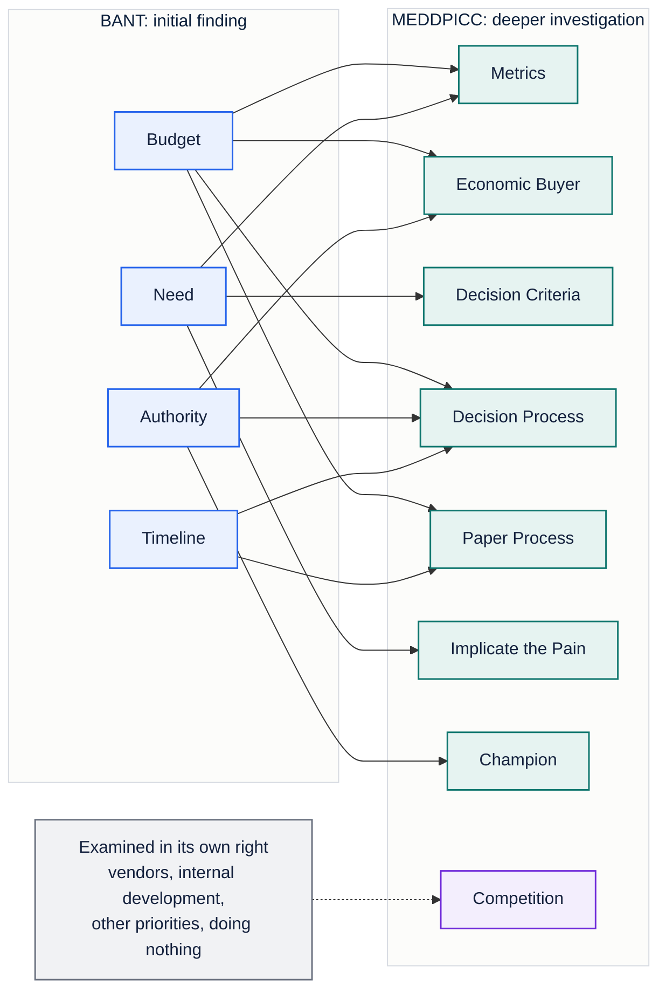
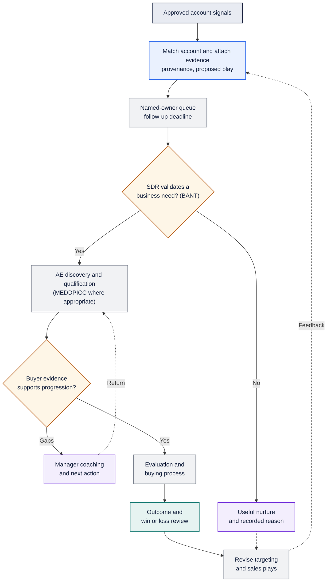
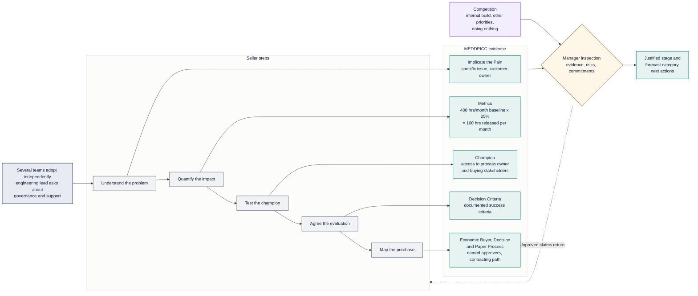

# Building the Revenue System

### A practical framework for connecting marketing, product adoption, inside sales and enterprise growth

**Dev Das** · [GitHub](https://github.com/HackrLife) · [Portfolio](https://dev-das.com/) · [LinkedIn](https://www.linkedin.com/in/devdulal/)

## The premise

A revenue organisation works through connected decisions: which markets to pursue, what problems to address, how to create demand, when to involve sales, how to qualify an opportunity and how to deliver enough customer value to earn expansion.

I developed this framework from my experience leading marketing, growth and inside-sales functions across enterprise technology businesses. It brings marketing planning, product-led growth, SDR execution, enterprise qualification, manager coaching and customer expansion into one operating approach.

The central question is practical: **how do we turn market opportunity and customer interest into repeatable commercial outcomes?**

My starting point is to identify where the system loses momentum. Training has limited effect if targeting is wrong. More leads do not solve weak qualification. Faster qualification does not resolve an unclear business case. Closing a deal does not establish a durable business if adoption fails.

The framework uses BANT for initial commercial qualification and MEDDPICC for complex opportunity qualification, alongside discovery, value messaging and technical evaluation playbooks. It also describes how automation can reduce administrative work without replacing seller judgement. It is adaptable to product-led, marketing-led, outbound and partner-led businesses; the appropriate depth depends on the customer, sales motion and deal complexity.

It is an operating framework, not a claim that every company needs the same methodology, technology stack or stage gates. Its first step is diagnosis.

## How the parts connect

| Layer | Core decision | Accountable partners | Evidence of progress |
|---|---|---|---|
| **Market and marketing strategy** | Which segments, problems and propositions merit investment? | Marketing, product marketing, commercial leadership | Segment economics, customer evidence and response to the proposition |
| **Demand and product adoption** | How do buyers discover, evaluate and experience value? | Marketing, Product, ecosystem teams | Qualified engagement, activation and sustained adoption |
| **Inside sales and qualification** | Which accounts need human attention and why? | SDR leadership, marketing, sales | Accepted opportunities and downstream progression |
| **Enterprise selling** | Is there a funded, supportable path to a purchase? | AEs, managers, solutions teams | Buyer evidence, evaluation outcomes and commercial commitments |
| **Customer value and expansion** | Did the customer achieve the intended outcome, and what should come next? | CS, account teams, Product, partners | Adoption, retention, realised value and qualified expansion |
| **Enablement and operations** | What capabilities, processes and information help every layer perform? | Enablement, RevOps and functional leaders | Productivity, process quality and reliable performance measurement |

Enablement supports each layer. Marketing and sales leaders remain accountable for their functions and commercial results.

## 1. The experience I would bring

My experience combines marketing and growth leadership with inside-sales operations. At SAP, I helped build an outsourced SDR model supporting mid-market subscription plays. At Adobe, I led digital growth and inside sales across APAC. At Google, I lead SMB and startup marketing, including the SDR functions for both segments.

That remit has required connecting marketing plans, acquisition programmes, qualification, onboarding, sales plays and handoffs. It has also taught me to distinguish a pipeline-generation problem from a seller-productivity problem before choosing an intervention.

| Company and remit | Selected results from my experience | Relevance to this proposal |
|---|---|---|
| **Google — SMB and startup marketing, growth and SDR leadership** | Pipeline grew from **$150M to $1.4B**; outbound contributes **33% of direct pipeline**. Win rate improved **31%** and average deal value **62%**. S1–S4 progression and closure for $40K deals fell from **nine months to three months**. | Connect demand, qualification and deal progression within one commercial operating model. |
| **Adobe — digital growth and inside sales** | Inside sales’ contribution to the quota-carrying book of business rose from **38% to 76%**. Ramp to **90% of target** fell from **six months to one quarter**. Competitive win rate improved from **10% to 42%**. | Build onboarding and sales plays around observable productivity and conversion outcomes. |
| **SAP — mid-market marketing and demand generation** | Helped build an outsourced SDR model with hubs in **Malaysia, Mexico, India, the Philippines and China**. Subscription pipeline generation time fell from **90 to 28 days**, sales cycles from **six months to 40 days**, and qualification conversion rose from **20% to 47%**. | Establish shared playbooks, onboarding and handoffs across distributed delivery teams and partners. |

These are results from different businesses, scopes and periods. They are not forecasts for another business, directly comparable cohorts or evidence that MEDDPICC alone caused the improvements. My Google win-rate figure is a relative improvement; the Adobe competitive win-rate figures are starting and ending rates.

I also build software and automation myself. My GitHub contains **40+ repositories**, and my workflow portfolio, built using n8n, documents **11 workflows** covering demand capture, account research, enrichment, CRM activation and AI evaluation. That gives me a practical basis for designing enablement around the product and its users.

## 2. Diagnose the constraint before installing the process

I would begin with recent wins, losses, stalled opportunities and new-hire cohorts across the relevant markets and sales motions. The aim would be to understand where performance varies and why.

| Question | Evidence to examine | Decision it informs |
|---|---|---|
| Which segments and propositions produce commercially valuable demand? | Marketing plans, campaign cohorts, acquisition costs, customer interviews and segment performance | Where to focus marketing investment and positioning |
| Which adoption signals predict a commercial conversation? | Available account-level signals, sales acceptance, qualification and conversion by source | Which accounts merit outreach and which need nurture |
| Where do opportunities stall? | Stage histories, call samples, evaluation plans, security and procurement milestones | Which sales plays and stage expectations need work |
| What delays new-hire productivity? | Cohort performance, manager feedback, observed discovery and product fluency | The onboarding milestones to prioritise |
| How do managers distinguish a credible deal from an optimistic one? | Deal reviews, forecast snapshots, slippage and missing buyer evidence | A common inspection and coaching approach |
| What is already working? | Regional playbooks, successful sellers, partner motions and customer examples | What to preserve, standardise and share |

I would segment findings by role, region, customer size, source and new business versus expansion. A shorter cycle can reflect a different deal mix; higher qualification conversion can reflect a changed denominator. Neither automatically demonstrates better enablement.

The output would be a baseline, a small number of priority problems and an agreed pilot. I would avoid launching a global training programme before establishing which behaviours need to change.

## 3. Choose qualification depth to match the opportunity

I would use **BANT — Budget, Authority, Need and Timeline —** as an initial qualification lens, particularly for SDR discovery, inbound enquiries and commercial inside-sales opportunities. For more complex buying processes, I would use **MEDDPICC** to develop and inspect the evidence in greater depth.

These are complementary lenses, not mandatory consecutive checklists. A simple purchase may need BANT and an appropriate closing process. A complex enterprise opportunity may warrant MEDDPICC from the first conversation. Neither framework should be applied so rigidly that sellers mistake an incomplete answer for the absence of a worthwhile opportunity.

> **Reading the schematics.** Navy marks a trigger, blue a source of evidence, grey a logic or seller step, orange a model-assisted step, amber a human decision, purple a return or exception path, and teal a recorded outcome. Dotted lines are feedback paths.

### BANT for initial commercial qualification

| Dimension | What the seller needs to understand | Useful discovery question | What to record |
|---|---|---|---|
| **Budget** | Whether funding exists or there is a credible path to securing it | How would an investment in solving this problem be funded and approved? | Funding status, approval route and unresolved assumptions |
| **Authority** | Who owns the problem, influences the decision and authorises expenditure | Who else would need to be involved in evaluating and approving a solution? | Stakeholders, their roles and a route to the decision-maker |
| **Need** | The specific problem, its consequence and its priority | What happens if this remains unresolved over the next six months? | Problem, affected process, impact and customer priority |
| **Timeline** | Why action is being considered now and what determines timing | What event or commitment makes this a priority, and what must happen before a decision? | Customer trigger, target dates and dependencies |

I would usually lead the conversation with the customer’s need and context, rather than open with a budget interrogation. The acronym is a memory aid, not the required order of discovery.

In product-led or emerging categories, a customer may have strong need before establishing a budget. An engaged user may also lack buying authority while providing a credible route to the people who hold it. Those are gaps to investigate. Conversely, a stated budget and deadline do not make an opportunity attractive if the product does not solve the problem.

Product fit, implementation feasibility and account economics therefore sit alongside BANT. A useful qualification outcome is a justified next action: sales engagement, further discovery, nurture or disqualification with a recorded reason.

**Figure 1. BANT qualification of an inbound commercial enquiry**

```mermaid
flowchart LR
    T1["Inbound enquiry<br/>demo or contact request"]:::trigger
    S1["Attach account context<br/>company, role, source"]:::source
    A1["Suggested summary of stated need<br/>with source reference"]:::ai

    subgraph BANT["BANT discovery, led by need"]
        direction TB
        N["Need<br/>problem, impact, priority"]:::logic
        B["Budget<br/>funding status, approval route"]:::logic
        AU["Authority<br/>stakeholders, route to decision-maker"]:::logic
        TI["Timeline<br/>trigger, dates, dependencies"]:::logic
    end

    F["Product fit, feasibility<br/>and account economics"]:::source
    C1{"Justified next action?"}:::check

    O1["Sales engagement<br/>AE handoff with buyer evidence"]:::store
    O2["Further discovery<br/>named gap and owner"]:::store
    X1["Nurture<br/>recorded reason"]:::exception
    X2["Disqualify<br/>recorded reason"]:::exception

    T1 --> S1 --> A1 --> N --> B --> AU --> TI --> C1
    F --> C1
    C1 -->|"Need and fit established"| O1
    C1 -->|"Credible need, open gaps"| O2
    C1 -->|"No current initiative"| X1
    C1 -->|"No fit"| X2
    O2 -.->|"Re-assess"| C1

    classDef trigger fill:#E8EBF2,stroke:#14213D,color:#14213D,stroke-width:1.5px
    classDef source fill:#EAF1FE,stroke:#2563EB,color:#14213D,stroke-width:1.5px
    classDef ai fill:#FDF0E8,stroke:#C2410C,color:#14213D,stroke-width:1.5px
    classDef logic fill:#F1F2F4,stroke:#6B7280,color:#14213D,stroke-width:1.5px
    classDef check fill:#FEF6E7,stroke:#B45309,color:#14213D,stroke-width:1.5px
    classDef exception fill:#F3EEFD,stroke:#6D28D9,color:#14213D,stroke-width:1.5px
    classDef store fill:#E6F3F1,stroke:#0F766E,color:#14213D,stroke-width:1.5px
    style BANT fill:#FCFCFA,stroke:#D6DAE1,color:#0B1F3A
```

### How BANT connects to MEDDPICC

| Initial BANT finding | Deeper MEDDPICC investigation | Handoff evidence |
|---|---|---|
| **Budget** — funding exists or can be sought | Economic Buyer and Metrics establish who can approve the investment and the value supporting it; Decision and Paper Processes clarify approval and contracting | Funding status and approval route, without treating a stated budget as a verified business case |
| **Authority** — stakeholders and roles identified | Economic Buyer, Champion and Decision Process distinguish influence, advocacy and spending authority | Stakeholder map and evidence of access or internal advocacy |
| **Need** — problem and consequence established | Implicate the Pain, Metrics and Decision Criteria turn the problem into a measurable, buyer-supported evaluation | Customer-stated problem, baseline and success requirements |
| **Timeline** — desired timing and trigger identified | Decision Process and Paper Process establish the actions and dependencies behind the date | Milestones, owners and constraints |

This is a practical mapping rather than a one-to-one equivalence. MEDDPICC also examines competition, including internal development, competing priorities and doing nothing. Those questions should not disappear simply because an account passes BANT.

**Figure 2. How initial BANT findings expand into MEDDPICC investigation**

### Apply the framework to the sales motion

| Sales motion | Initial approach | When to deepen qualification |
|---|---|---|
| **Inbound commercial enquiry** | BANT plus product fit and a clear next step | Multiple approvers, technical evaluation or contracting complexity emerge |
| **Product-led account** | Validate the use case and commercial need, then explore BANT | Wider deployment, a cross-functional business case or enterprise requirements emerge |
| **Strategic enterprise account** | Begin MEDDPICC discovery early, using BANT questions where helpful | Build evidence progressively through evaluation, approval and contracting |
| **Partner-led opportunity** | Establish end-customer need, funding and stakeholders, and clarify partner responsibilities | Separate the end-customer buying process from partner selection, implementation and commercial dependencies |

The SDR-to-AE handoff would carry the original buyer evidence, not just four checked boxes. The AE would validate it and deepen qualification as appropriate. Repeated rejection reasons would inform SDR coaching and marketing targeting.

### MEDDPICC as a shared language for buyer evidence

MEDDPICC provides eight dimensions for qualifying and inspecting opportunities: **Metrics, Economic Buyer, Decision Criteria, Decision Process, Paper Process, Implicate the Pain, Champion and Competition**.[1]

For a technical B2B business, I would translate each dimension into evidence a seller can obtain and a manager can inspect.

| Dimension | Evidence I would look for | What would remain unproven |
|---|---|---|
| **Metrics** | A customer-agreed baseline, desired improvement and method of measurement | An ROI estimate created entirely by the seller |
| **Economic Buyer** | The person with spending authority, their priorities and a credible route to engagement | A senior title or a contact who can recommend expenditure |
| **Decision Criteria** | Buyer-ranked technical, operational and commercial requirements | A feature list with no agreed weighting |
| **Decision Process** | Who evaluates, who approves and how a selection is made | A target date without the decisions needed to reach it |
| **Paper Process** | The steps, owners and timing between selection and signature | An assumption that legal and procurement will be straightforward |
| **Implicate the Pain** | A specific operational problem and the consequence of leaving it unresolved | General interest in automation or AI |
| **Champion** | Someone with influence, a reason to act and demonstrated willingness to mobilise others | An enthusiastic user who has not influenced the buying process |
| **Competition** | Vendors, internal development, other funded priorities and the option to do nothing | Only the competing product named in discovery |

MEDDPICC would not replace the selling process. For low-complexity, transactional sales, a lighter qualification approach may be more appropriate. Sellers would still need discovery prompts, value narratives, evaluation plans, objection handling and commercial negotiation support. The framework would help them see what they know, what they are assuming and what to do next.

### Progressive qualification rather than universal gates

I would define stage expectations with sales leadership and test them on actual opportunities. Early discovery might require a credible problem, an accountable contact and a next step. Later stages would require stronger evidence of decision authority, evaluation success and the route to signature.

For each important claim, the record should capture its source, last validation date, owner and next action. A field marked complete should not be treated as proof. Unknowns should remain visible, and exceptions should have a named manager and rationale.

## 4. Convert adoption into account opportunities without assuming visibility

The first dependency is a signal inventory. Cloud products, self-hosted software, marketing systems and partner programmes expose different information. Product analytics collected for one purpose should not automatically be assumed to provide an identifiable, usable sales signal. Account matching, permitted use and actual availability need to be established with the data owners.

I would work with Product, RevOps and the relevant data owners to establish what is available, reliable and appropriate to use.

| Source | Potential evidence to validate | Proposed response |
|---|---|---|
| **Identified cloud accounts** | Sustained usage growth, account structure and enterprise-feature enquiries, where available | Explore the business process and requirements behind adoption |
| **Identified self-hosted organisations** | Customer-supplied deployment details, commercial enquiries and support interactions | Discuss deployment, governance, support and commercial needs |
| **Community and marketing engagement** | Identifiable event registrations, workshops and explicit requests for help | Offer relevant assistance and establish whether a buying initiative exists |
| **Existing customers** | Agreed adoption measures, account plans and new departmental demand | Coordinate expansion discovery with the AE and CS owner |

I would not assume access to workflow payloads, sensitive data flows or identifiable telemetry from every community installation. Nor would I equate activity with purchase intent.

At enterprise level, I would aggregate suitable signals into a **product-qualified account hypothesis**. Multiple users associated with the same verified organisation can be relevant; multiple unrelated company domains are not evidence of density within one account. Any initial numerical threshold would be a test parameter, not an established predictor.

A signal would enter a named-owner queue with its provenance, account match, proposed play and follow-up deadline. The SDR would validate the need, and the AE would accept or reject the opportunity using explicit criteria. Rejection reasons would feed back into targeting and scoring. Accounts without a buying initiative would return to useful nurture rather than repeated sales outreach.

**Figure 3. From approved account signal to outcome review**

## 5. A worked opportunity example

**Illustrative scenario — not an actual customer or a forecast.** A company has several teams adopting a technical platform independently. An engineering lead asks about central governance and support as adoption expands.

That is a reason for discovery, not proof of budget or a qualified enterprise deal.

| Step | Seller action | Evidence required to progress |
|---|---|---|
| **Understand the problem** | Ask which workflows matter, who maintains them and where current arrangements fail | A specific operational issue and a customer owner |
| **Quantify the impact** | Agree a baseline for maintenance effort or another relevant outcome | Customer-validated inputs and a measurement plan |
| **Test the champion** | Ask the engineering lead to arrange a discussion with the process owner and buying stakeholders | Observable internal advocacy and access |
| **Agree the evaluation** | Select representative workflows and document success criteria | A scoped plan, responsible people and a review date |
| **Map the purchase** | Establish budget authority, selection requirements and the contracting path | Named decision-makers, approval steps and outstanding dependencies |
| **Inspect the opportunity** | Review evidence, unresolved risks and customer commitments with the manager | A justified stage and forecast category, with clear next actions |

**Figure 4. Worked example: each seller step and the MEDDPICC evidence it establishes**

The 100-hour figure requires a customer-validated baseline and a measured evaluation result; it becomes a financial value only with an agreed labour-cost assumption.

For example, if the customer validates 400 hours of monthly maintenance effort and an evaluation measures a 25% reduction, the estimate is **100 hours of capacity released per month**. Monetisation requires an agreed labour-cost assumption. That capacity should not be represented as cash savings unless expenditure will actually fall. Licence, hosting, model, implementation and ongoing operating costs also belong in the business case.

This is the connection I want sellers to make: product capability, a measurable operational change, and a buyer-supported commercial decision.

### Carry the value case into adoption and expansion

At close, the account should transfer with the agreed business outcomes, evaluation findings, stakeholder map, implementation responsibilities and success measures intact. CS and implementation partners should not need to reconstruct why the customer bought.

Account reviews would compare realised outcomes with the original case, identify adoption barriers and assess where an additional use case has a credible owner and benefit. Marketing can support customer education and relevant use-case discovery; the account team should qualify expansion rather than assume usage growth guarantees budget. Retention and expansion findings should feed back into targeting, messaging and product priorities.

## 6. Build role-specific ramp with common standards

I would use a 30/60/90-day structure for onboarding, while setting productivity expectations against actual sales cycles and role responsibilities. Completing 90 days would not automatically mean reaching full quota.

| Role | First 30 days | Days 31–60 | Days 61–90 |
|---|---|---|---|
| **SDR** | Build a workflow, learn account fit and observe discovery calls | Practise BANT discovery, document gaps and execute supervised outreach | Demonstrate consistent accepted-opportunity quality and progress toward the agreed target |
| **AE** | Build a workflow, learn buyer problems and shadow live deals from week one | Run observed discovery, deepen qualification through MEDDPICC where appropriate, and prepare a value case and evaluation plan | Progress live opportunities with evidence-based inspection; track productivity separately from training completion |
| **Manager** | Review qualification standards and inspect sample deals | Calibrate coaching and forecast judgements with peers | Run the coaching cadence independently and identify recurring gaps |
| **CS and partners** | Learn deployment, adoption and handoff expectations | Practise identifying expansion needs and maintaining account context | Execute coordinated adoption or expansion plays with named owners |

Certification would involve doing the work: a product demonstration, a discovery conversation, a value case and a deal review appropriate to the role. Sellers who need support would receive specific coaching and reassessment. Managers would be calibrated first so that certification means the same thing across regions.

My Adobe experience—reducing ramp to 90% of target from six months to one quarter—provides relevant experience. It would not justify promising the same outcome for enterprise AEs in a different business before inspecting the baseline.

## 7. Make manager coaching the reinforcement mechanism

Weekly reviews should result in decisions: what needs validation, which stakeholder needs engaging, what support the seller requires and whether the forecast is credible.

I would give managers a short inspection guide built around questions such as:

- What changed in the buyer’s situation since the last review?
- Which important claims are supported by buyer evidence?
- What has the proposed champion done to advance the purchase?
- What could stop the customer from deciding or signing?
- What is the next customer-agreed action, who owns it and when is it due?

Regional managers would periodically review the same sample opportunities and compare judgements. Enablement would use those differences to improve the rubric and coaching. PMM would receive recurring objections and win/loss findings; Product and solutions engineering would receive evaluation and deployment friction.

## 8. Automate the work around commercial judgement

The following are proposed applications, separate from my existing workflow portfolio. They can be implemented through workflow orchestration, CRM-native automation or custom code. I would choose the technology after establishing integration needs, permissions, reliability, operating cost and ownership.

| Proposed workflow | Trigger and output | Human decision retained |
|---|---|---|
| **Account-signal triage** | An approved signal is matched, deduplicated and routed with supporting evidence | SDR validates relevance; AE accepts the opportunity |
| **Qualification evidence assistant** | Authorised notes or call summaries produce suggested BANT or MEDDPICC updates with source references | Seller verifies evidence before CRM updates; manager owns stage and forecast decisions |
| **Ramp milestone tracking** | Joiner and assessment records identify completed milestones and coaching needs | Manager approves readiness and exceptions |
| **Deal-risk briefing** | Stage ageing, missing evidence and overdue customer actions create a review queue | Manager decides which risks matter and what action to take |
| **Win/loss feedback routing** | Closed-opportunity feedback is organised into themes for sales, PMM and Product | Owners validate themes and prioritise changes |

The workflows would use the actual systems of record, permissions and data-retention rules agreed with their owners. Deterministic logic would handle routing and validation. Where a model extracts or summarises evidence, the output would remain a suggestion with a source reference. Missing evidence would stay missing; a model should not infer a confirmed buyer, budget or champion from ambiguous language.

## 9. Deliver in phases with clear ownership

A lean starting team needs a narrow first release and active participation from managers and cross-functional owners. The plan below assumes an enablement lead and one or two ICs, supported by existing functional teams. It is an illustrative resourcing model, not a universal requirement.

| Period | Priority | Concrete output | Decision to proceed |
|---|---|---|---|
| **Days 1–30** | Diagnose and align | Baseline scorecard, signal inventory, process review and agreed pilot scope | Commercial leadership agrees the priority problem and sponsor |
| **Days 31–60** | Build and pilot | Manager rubric, qualification guide, one account-conversion play and role-specific onboarding milestones | Pilot teams can apply the standards and capture evidence consistently |
| **Days 61–90** | Inspect and refine | Pilot readout, revised materials and the first useful automation | Expand only where adoption, quality and early performance justify it |
| **Months 4–6** | Extend coverage | Regional rollout, CS and partner modules, ongoing cohort reporting | Review commercial outcomes as sufficient opportunities and cohorts mature |

The enablement lead would own programme design, sequencing and cross-functional alignment. An IC could own onboarding and certification; a second could own playbooks and field reinforcement. With only one IC, I would sequence those workstreams and use designated regional champions rather than launch everything at once.

Sales leadership would own selling expectations and manager participation. Managers would own coaching and readiness decisions. RevOps would own CRM definitions, reporting and workflow governance. PMM would own core positioning and competitive claims; Product and solutions engineering would validate technical content. Enablement would connect these contributions into a system sellers can use.

## 10. Measure behaviour and commercial outcomes separately

I would agree metric definitions before rollout and report results by comparable cohorts. Certification and content usage can diagnose adoption; they cannot by themselves demonstrate commercial impact.

| Measure | Definition and interpretation |
|---|---|
| **Time to productivity** | Days from role start to a role-specific output threshold sustained for an agreed period; reported separately from first deal and training completion |
| **Opportunity acceptance and quality** | Accepted opportunities divided by submitted opportunities, with rejection reasons and downstream progression |
| **Win rate** | Closed-won divided by closed-won plus closed-lost opportunities within the defined cohort; no-decision handling stated explicitly |
| **Cycle time** | Median elapsed days from a consistently defined entry point to close, alongside ageing of still-open opportunities |
| **Forecast accuracy and slippage** | Forecast-versus-actual performance from fixed forecast snapshots, plus the share of expected closes pushed beyond the period |
| **Quota attainment** | Median attainment and the proportion of eligible, ramped reps reaching 100% of quota, shown separately |
| **PLG-to-enterprise conversion** | Progression from eligible account signals to accepted opportunities and closed business within defined observation windows |
| **Methodology adoption** | Sampled quality and freshness of buyer evidence, manager coaching consistency and observed certification performance |

Initial improvement targets would be set after baseline analysis. I would compare pilot cohorts with suitable earlier or concurrent cohorts, accounting for tenure, region, source and deal mix. Early results would be directional where samples are small or sales cycles have not matured. Revenue performance is a joint outcome of product, demand, selling, market conditions and enablement; attribution should reflect that.

## Closing perspective

The revenue system I would build connects marketing choices with customer adoption, sales execution and the value delivered after purchase. It gives sellers a practical way to qualify a buying initiative, demonstrate value and navigate a decision. It gives managers a consistent way to coach, and leadership a clearer view of where intervention will help.

My contribution combines experience leading marketing and inside sales with the ability to build the workflows supporting them. The first milestone is a working pilot with credible evidence, followed by a rollout shaped by what it teaches us.

## Sources and scope

1. **MEDDICC — MEDDIC / MEDDPICC Sales Methodology and Process.** Source for framework terminology and definitions. https://meddicc.com/meddpicc-sales-methodology-and-process
2. **Dev Das — career experience and workflow portfolio.** Source for personal results and existing build examples. Career metrics describe different scopes and periods; they are separate from proposed outcomes for other businesses.

The operating approach, rollout sequence and illustrative examples are my synthesis. BANT and MEDDPICC are established frameworks referenced within it, not methodologies I claim to have invented. Workflow designs are implementation proposals unless explicitly identified as existing portfolio work.

Prepared October 2026. Adapt the framework to the company’s customer segments, sales motion, product economics and operating constraints.
